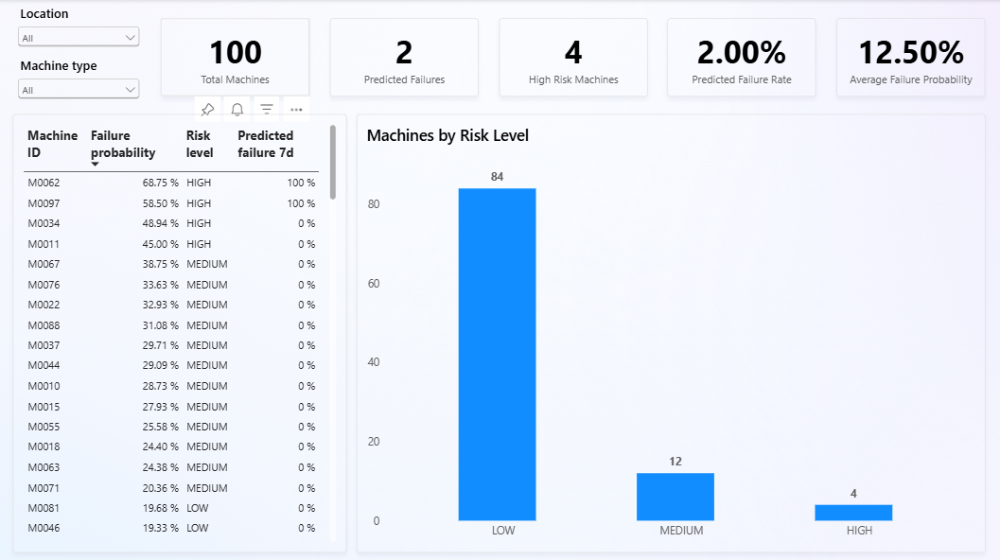

# Microsoft Fabric Predictive Maintenance Platform

A Microsoft Fabric portfolio project demonstrating an end-to-end predictive-maintenance workflow with deterministic synthetic data, a Medallion architecture, PySpark feature engineering, MLflow model management, LightGBM batch scoring, Direct Lake, DAX, and Power BI.

> [!NOTE]
> This project uses synthetic demonstration data. Failure-linked degradation profiles are intentionally injected into telemetry to create a controlled machine-learning scenario. Model results do not represent validated performance on production industrial equipment.

## Business objective

The platform estimates whether each machine is at risk of failure within the next seven days and supports maintenance teams with:

- fleet-health monitoring
- probability-based machine ranking
- separate operational risk categories and binary model alerts
- preventive inspection prioritization
- comparisons by location and machine type
- telemetry and maintenance context for investigation

## Architecture

```mermaid
flowchart LR
    A[Deterministic synthetic data] --> B[Bronze Delta tables]
    B --> C[Validated Silver tables]
    C --> D[Gold daily features]
    D --> E[Chronological train validation test split]
    E --> F[LightGBM training]
    F --> G[MLflow experiment and registered model]
    G --> H[Approved champion model version]
    H --> I[Version-bound batch scoring]
    I --> J[Prediction history]
    J --> K[Current risk snapshot]
    K --> L[Direct Lake semantic model]
    L --> M[Power BI dashboard]
```



## Technology stack

| Area | Technology |
| --- | --- |
| Unified analytics platform | Microsoft Fabric |
| Storage | OneLake and Fabric Lakehouse |
| Processing | PySpark and Spark SQL |
| Table format | Delta Lake |
| Data architecture | Bronze, Silver, and Gold Medallion layers |
| Machine learning | LightGBM and scikit-learn pipelines |
| Experiment tracking | MLflow |
| Model management | Fabric ML Model with version tags |
| Semantic model | Direct Lake |
| Business logic | DAX |
| Reporting | Power BI |
| Version control | Native Fabric Git integration with GitHub |

## Fabric items

| Item | Type | Purpose |
| --- | --- | --- |
| `00_generate_demo_data_fabric` | Notebook | Generates deterministic synthetic Bronze data. |
| `01_silver_transformation_fabric` | Notebook | Standardizes and validates Bronze data. |
| `02_feature_engineering_fabric` | Notebook | Creates leakage-aware daily Gold features. |
| `03_model_training_fabric` | Notebook | Trains, evaluates, registers, and tags the approved model version. |
| `03_model_training_fabric` | Experiment | Stores the current MLflow training run. |
| `04_batch_scoring_fabric` | Notebook | Loads the approved model and writes prediction history. |
| `05_reporting_layer_fabric` | Notebook | Builds the current reporting snapshot. |
| `lh_predictive_maintenance` | Lakehouse | Stores Bronze, Silver, Gold, history, and snapshot tables. |
| `predictive_maintenance_lightgbm` | ML Model | Stores registered LightGBM model versions. |
| `Predictive Maintenance Analytics` | Semantic model | Direct Lake model and DAX measures. |
| `Predictive Maintenance Dashboard` | Report | Interactive operational dashboard. |

Legacy notebooks without the `_fabric` suffix were removed from the current workspace after the hardened pipeline was validated. Earlier versions remain recoverable through Git history and the Fabric Recycle bin.

## Repository structure

```text
fabric-predictive-maintenance/
├── 00_generate_demo_data_fabric.Notebook/
├── 01_silver_transformation_fabric.Notebook/
├── 02_feature_engineering_fabric.Notebook/
├── 03_model_training_fabric.Notebook/
├── 03_model_training_fabric.MLExperiment/
├── 04_batch_scoring_fabric.Notebook/
├── 05_reporting_layer_fabric.Notebook/
├── lh_predictive_maintenance.Lakehouse/
├── predictive_maintenance_lightgbm.MLModel/
├── Predictive Maintenance Analytics.SemanticModel/
├── Predictive Maintenance Dashboard.Report/
├── docs/
│   └── images/
│       └── predictive-maintenance-dashboard.png
├── LICENSE
└── README.md
```

Fabric-generated artifact definitions are changed in Microsoft Fabric and committed through native Fabric Git integration. They are not edited manually in GitHub.

## Data pipeline

### 1. Deterministic Bronze generation

`00_generate_demo_data_fabric` uses the fixed reference timestamp:

```text
2026-11-06 14:00:00 UTC
```

Repeated runs therefore produce the same logical date range and identifiers rather than shifting with `datetime.now()` or `current_date()`.

Validated Bronze tables:

| Table | Rows |
| --- | ---: |
| `bronze_machine_master` | 100 |
| `bronze_failure_events` | 150 |
| `bronze_maintenance_events` | 300 |
| `bronze_machine_telemetry` | 1,728,000 |

Telemetry contains 180 days of 15-minute observations for 100 machines. The generator creates deterministic baseline sensor behavior, failure-specific degradation profiles, variable warning windows, and background anomalies to create class overlap.

### 2. Silver transformation

`01_silver_transformation_fabric` performs:

- explicit type casting
- identifier normalization
- controlled-category validation
- future-date validation against the fixed reference date
- deterministic rejection of duplicate business keys
- uniqueness checks for `telemetry_id`
- uniqueness checks for `(machine_id, telemetry_timestamp)`
- orphan checks for failure, maintenance, and telemetry records
- technical range validation for all sensor values

Validated Silver tables preserve the Bronze row counts:

| Table | Rows |
| --- | ---: |
| `silver_machine_master` | 100 |
| `silver_failure_events` | 150 |
| `silver_maintenance_events` | 300 |
| `silver_machine_telemetry` | 1,728,000 |

### 3. Gold feature engineering

`02_feature_engineering_fabric` produces one record per machine and complete day. It reports and excludes incomplete machine-days rather than silently treating them as complete.

The feature set includes:

- daily temperature, vibration, pressure, speed, power, and load statistics
- one-day changes for selected telemetry measures
- seven-day rolling averages
- maintenance count, duration, and cost over the previous 30 days
- `has_maintenance_history`
- `days_since_last_maintenance`
- machine attributes and machine age
- seven-day future-failure target

The final table is:

```text
gold_machine_features_daily
```

Validated output:

| Metric | Result |
| --- | ---: |
| Machine-day rows | 17,900 |
| Machines | 100 |
| Positive target rows | 1,044 |
| Positive rate | 5.83% |

The notebook verifies that known leakage columns such as failure dates, failure IDs, helper degradation signals, and future-event fields are absent from model inputs.

## Model training and evaluation

`03_model_training_fabric` uses a chronological split rather than a random row split:

- training: earliest 70% of feature dates
- validation: next 15%
- test: latest 15%

This prevents neighboring machine-days from being randomly mixed across training and evaluation datasets.

The notebook compares Logistic Regression with LightGBM, handles class imbalance, encodes categorical values with unknown-category support, and stores preprocessing with the classifier in one scikit-learn pipeline.

Reported metrics include:

- PR AUC
- ROC AUC
- precision
- recall
- F1 score
- confusion-matrix counts
- train-to-validation ROC AUC gap

### Threshold policy

The decision threshold is selected on the validation set using an explicit policy:

```text
maximize validation F1 subject to precision >= 0.25
```

The selected threshold is stored as a tag on the exact registered model version. The test set is then used once for final evaluation and is not used for further threshold tuning.

### Approved model version

Microsoft Fabric returned HTTP `404` for MLflow registered-model aliases. The project therefore uses a Fabric-compatible model-version tag:

```text
deployment_status = champion
```

The scoring notebook selects the registered version carrying this tag and reads the `decision_threshold` tag from the same version. This prevents model-version and threshold mismatches.

The registered model is:

```text
predictive_maintenance_lightgbm
```

## Batch scoring

`04_batch_scoring_fabric`:

- loads the registered version tagged `deployment_status = champion`
- reads the version-bound decision threshold
- validates that required model features exist
- checks feature freshness
- scores the latest feature date for all 100 machines
- stores probability and binary alert separately
- assigns operational risk levels
- records model name, version, deployment status, threshold, and UTC scoring timestamp

### Prediction history

Predictions are retained in:

```text
gold_failure_predictions_history
```

The notebook uses an idempotent Delta `MERGE` key comprising machine, feature date, model version, and threshold. Repeating the same scoring configuration updates the same logical records instead of discarding all history.

Primary output fields:

| Column | Description |
| --- | --- |
| `machine_id` | Unique machine identifier. |
| `feature_date` | Date represented by the scored features. |
| `failure_probability` | Continuous seven-day failure probability. |
| `model_alert` | Binary decision produced with the version-bound threshold. |
| `risk_level` | Operational band independent of the binary alert. |
| `model_name` | Registered model name. |
| `model_version` | Exact version used for scoring. |
| `deployment_status` | Version approval tag, currently `champion`. |
| `decision_threshold` | Threshold associated with the selected version. |
| `prediction_timestamp_utc` | UTC scoring timestamp. |

## Reporting layer

`05_reporting_layer_fabric` builds the current snapshot:

```text
gold_maintenance_risk_current
```

The snapshot combines current predictions, machine attributes, telemetry features, maintenance features, model metadata, inspection priority, and recommended action.

The reporting contract intentionally separates:

- `failure_probability`, a continuous model output
- `risk_level`, an operational probability band
- `model_alert`, a stricter binary decision

A machine can therefore be `HIGH` risk while `model_alert = 0`. The Power BI report presents these as different concepts.

## Risk classification

| Risk level | Probability range | Interpretation |
| --- | ---: | --- |
| `LOW` | below 20% | Continue standard monitoring. |
| `MEDIUM` | 20% to below 40% | Review within seven days. |
| `HIGH` | 40% to below 70% | Inspect within 72 hours. |
| `CRITICAL` | 70% or above | Inspect within 24 hours. |

The binary alert threshold is not hardcoded in the reporting layer. It is loaded from the approved model version during scoring.

## Current validated scoring results

The final full run of notebooks `00–05` produced:

| Metric | Result |
| --- | ---: |
| Total machines | 100 |
| Model alerts | 0 |
| Model alert rate | 0.00% |
| Average failure probability | 12.50% |
| Low-risk machines | 33 |
| Medium-risk machines | 57 |
| High-risk machines | 10 |
| Critical-risk machines | 0 |

Zero model alerts is a valid outcome. The approved threshold was not lowered merely to force positive predictions.

## Semantic model

The Direct Lake semantic model is stored as:

```text
Predictive Maintenance Analytics.SemanticModel
```

The report uses `gold_maintenance_risk_current` for operational KPIs, machine details, and risk distribution. `gold_machine_features_daily` remains available for feature-level analysis.

Core DAX measures:

```DAX
Total Machines Current =
DISTINCTCOUNT(
    gold_maintenance_risk_current[machine_id]
)
```

```DAX
Model Alerts =
SUM(
    gold_maintenance_risk_current[model_alert]
)
```

```DAX
Model Alert Rate =
DIVIDE(
    [Model Alerts],
    [Total Machines Current],
    0
)
```

```DAX
Average Failure Probability =
AVERAGE(
    gold_maintenance_risk_current[failure_probability]
)
```

```DAX
High Risk Machines Current =
CALCULATE(
    DISTINCTCOUNT(
        gold_maintenance_risk_current[machine_id]
    ),
    gold_maintenance_risk_current[risk_level] = "HIGH"
        || gold_maintenance_risk_current[risk_level] = "CRITICAL"
)
```

## Power BI dashboard

The report is stored as:

```text
Predictive Maintenance Dashboard.Report
```



The dashboard includes:

- total machines
- model alerts
- high- or critical-risk machines
- model alert rate
- average failure probability
- machine distribution by risk level
- location slicer
- machine-type slicer
- machine-level probability, risk, and alert table

Both slicers were validated against all KPI cards, the risk chart, and the machine table.

## End-to-end validation

The final hardening run confirmed:

- 20 of 20 Spark jobs succeeded for deterministic Bronze generation
- 20 of 20 Spark jobs succeeded for Silver transformation
- 20 of 20 Spark jobs succeeded for feature engineering
- the MLflow training run completed successfully
- 20 of 20 Spark jobs succeeded for batch scoring
- 19 of 19 Spark jobs succeeded for the reporting layer
- 1,728,000 unique telemetry records
- 17,900 Gold machine-day feature records
- 100 current machine scores
- no null current predictions
- prediction history retained
- current reporting snapshot created
- model alert and risk level separated
- Direct Lake report KPIs and slicers validated
- native Fabric-to-Git synchronization completed with zero pending changes

## Reproducing the project

### Prerequisites

- Microsoft Fabric workspace on supported capacity or an active trial
- permission to create and run Fabric notebooks, Lakehouse, Data Science, semantic-model, and report items
- Fabric Git integration with GitHub
- PySpark, LightGBM, scikit-learn, pandas, NumPy, Delta Lake, and MLflow available in the Fabric runtime

### Execution order

Run the notebooks in this exact order:

```text
00_generate_demo_data_fabric
01_silver_transformation_fabric
02_feature_engineering_fabric
03_model_training_fabric
04_batch_scoring_fabric
05_reporting_layer_fabric
```

After execution:

1. Confirm the model version has `deployment_status = champion` and a `decision_threshold` tag.
2. Confirm `gold_failure_predictions_history` contains the current model version.
3. Confirm `gold_maintenance_risk_current` contains one current record per machine.
4. Refresh the Direct Lake semantic model or report visuals if needed.
5. Validate KPI values, risk distribution, table values, and both slicers.

## Security and operational considerations

- The project contains synthetic data and no customer or production telemetry.
- No secrets, passwords, tokens, or connection strings should be committed.
- Workspace identities, permissions, capacity, and regional settings must be validated separately after restore.
- The scoring notebook rejects stale features beyond its configured tolerance.
- Production deployment should use a controlled model-approval process rather than relying solely on a text tag.
- The current project demonstrates batch inference, not real-time safety monitoring.

## Known limitations

- Data and failure mechanisms are synthetic.
- Injected degradation profiles are based on known synthetic future failures.
- Model metrics validate the workflow, not production industrial performance.
- Risk bands are operational heuristics rather than calibrated maintenance-service levels.
- MLflow registered-model aliases were unavailable in the tested Fabric environment; version tags are used instead.
- Streaming ingestion and online inference are not implemented.
- Automated work-order creation and alert delivery are outside the current scope.
- SHAP explanations are not persisted for individual predictions.
- Drift monitoring and automated retraining are not implemented.
- Prediction-outcome reconciliation requires future observed failure data.

## Potential extensions

- SHAP-based local explanations
- probability calibration
- event-level failure-detection metrics
- cost-sensitive threshold optimization
- prediction-outcome reconciliation
- model and data drift monitoring
- automated retraining with approval gates
- Eventstream ingestion and real-time feature processing
- Power Automate or Teams maintenance notifications
- enterprise asset-management integration
- Development, Test, and Production deployment pipelines

## AI-assisted development disclosure

Developed by Kamil Soszka with Microsoft Copilot used as the sole AI-assisted development partner for architecture review, PySpark and ML refinement, documentation, validation, and troubleshooting. All environment operations, implementation decisions, testing, and final acceptance were performed by the project owner.

## Skills demonstrated

- Microsoft Fabric Data Engineering
- Fabric Data Science and MLflow
- PySpark and Spark SQL
- Delta Lake and Medallion architecture
- deterministic synthetic-data engineering
- leakage-aware feature engineering
- chronological model evaluation
- LightGBM and scikit-learn pipelines
- model-version governance
- idempotent batch scoring
- Direct Lake semantic modeling
- DAX and Power BI
- native Fabric Git integration

## Project status

The current hardening stage is complete for:

- deterministic data generation
- Bronze, Silver, and Gold processing
- feature engineering
- chronological model training and evaluation
- registered-model version governance
- version-bound threshold management
- historical batch scoring
- current reporting snapshot
- Direct Lake semantic model
- Power BI dashboard
- Git synchronization
- technical validation

## License

This project is licensed under the [MIT License](LICENSE).
