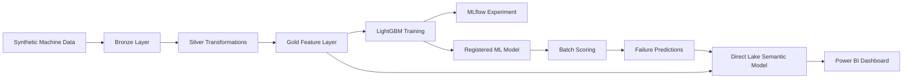

# Microsoft Fabric Predictive Maintenance Platform

End-to-end predictive maintenance platform built with Microsoft Fabric, PySpark, MLflow, LightGBM, Direct Lake, DAX, and Power BI.

The solution processes industrial machine telemetry and maintenance data through a Medallion architecture, engineers machine-level features, trains a binary classification model, generates seven-day failure predictions, and exposes operational insights through an interactive Power BI dashboard.

## Project Overview

The platform identifies machines at elevated risk of failure within the next seven days.

The solution includes:

- synthetic industrial data generation
- Bronze, Silver, and Gold data layers
- telemetry and maintenance feature engineering
- LightGBM model training
- MLflow experiment tracking
- registered model management
- batch inference
- machine-level risk classification
- Direct Lake semantic modeling
- reusable DAX measures
- interactive Power BI reporting
- Git integration between Microsoft Fabric and GitHub

## Business Objective

Unexpected equipment failures can cause production downtime, emergency maintenance costs, and operational disruption.

This project provides a data-driven maintenance workflow that enables operations teams to:

- monitor machine-fleet health
- identify machines with elevated failure probability
- prioritize preventive inspections
- compare risk across locations and machine types
- investigate telemetry and maintenance patterns
- support maintenance planning with model-generated risk scores

## Architecture



## Technology Stack

| Area | Technology |
|---|---|
| Data platform | Microsoft Fabric |
| Storage | OneLake and Fabric Lakehouse |
| Data processing | PySpark and Spark SQL |
| Table format | Delta Lake |
| Architecture | Medallion architecture |
| Machine learning | LightGBM |
| Experiment tracking | MLflow |
| Model management | Fabric ML Model |
| Semantic layer | Direct Lake semantic model |
| Business logic | DAX |
| Reporting | Power BI |
| Version control | GitHub and Fabric Git integration |

## Repository Structure

```text
fabric-predictive-maintenance/
├── 00_generate_demo_data.Notebook/
├── 01_silver_transformation.Notebook/
├── 02_feature_engineering.Notebook/
├── 03_model_training.Notebook/
├── 03_model_training.MLExperiment/
├── 04_batch_scoring.Notebook/
├── 05_reporting_layer.Notebook/
├── lh_predictive_maintenance.Lakehouse/
├── predictive_maintenance_lightgbm.MLModel/
├── Predictive Maintenance Analytics.SemanticModel/
├── Predictive Maintenance Dashboard.Report/
├── docs/
│   └── images/
│       └── predictive-maintenance-dashboard.png
├── LICENSE
└── README.md
```

## Data Pipeline

### 1. Demo Data Generation

The `00_generate_demo_data` notebook creates a reproducible industrial dataset containing:

- machine master data
- machine telemetry
- maintenance events
- failure events

The generated dataset represents 100 machines across multiple locations and machine types.

### 2. Silver Transformations

The `01_silver_transformation` notebook:

- validates source records
- standardizes data types
- removes invalid or duplicate records
- prepares telemetry and maintenance data for analytical processing
- creates cleaned Silver-layer tables

### 3. Feature Engineering

The `02_feature_engineering` notebook creates daily machine-level features, including:

- machine age
- telemetry sample count
- temperature statistics
- vibration statistics
- pressure statistics
- rotation-speed statistics
- power-consumption statistics
- machine-load statistics
- maintenance activity during the previous 30 days
- days since the latest maintenance event
- seven-day failure target

The final feature table is:

```text
gold_machine_features_daily
```

### 4. Model Training

The `03_model_training` notebook trains a LightGBM binary classification model.

The model predicts whether a machine is likely to fail within the following seven days.

The training workflow includes:

- feature selection
- categorical-feature handling
- training and test separation
- LightGBM model training
- probability prediction
- classification evaluation
- MLflow experiment logging
- model registration in Microsoft Fabric

The registered model is:

```text
predictive_maintenance_lightgbm
```

### 5. Batch Scoring

The `04_batch_scoring` notebook:

- loads the registered model
- selects the latest machine features
- calculates failure probabilities
- applies the decision threshold
- assigns operational risk levels
- writes prediction results to the Gold layer

The final prediction table is:

```text
gold_failure_predictions
```

### 6. Reporting Layer

The `05_reporting_layer` notebook prepares reporting-ready data and validates the final analytical outputs used by the semantic model and Power BI report.

## Prediction Output

The prediction table contains the following primary fields:

| Column | Description |
|---|---|
| `machine_id` | Unique machine identifier |
| `feature_date` | Feature-calculation date |
| `failure_probability` | Model-generated probability of failure |
| `predicted_failure_7d` | Binary seven-day failure prediction |
| `risk_level` | Operational risk category |
| `decision_threshold` | Probability threshold used for classification |
| `model_name` | Registered model name |
| `model_version` | Model version used during scoring |
| `prediction_timestamp` | Batch-scoring timestamp |

## Risk Classification

The scoring layer assigns machines to three operational risk categories:

| Risk level | Interpretation |
|---|---|
| `LOW` | Low estimated failure probability |
| `MEDIUM` | Elevated probability requiring monitoring |
| `HIGH` | High-priority machine requiring inspection |

The binary prediction uses a decision threshold of `0.50`.

A machine can be classified as `HIGH` risk without receiving a binary failure prediction when its probability is elevated but remains below the decision threshold.

## Current Scoring Results

The validated scoring run produced predictions for 100 machines:

| Metric | Result |
|---|---:|
| Total machines | 100 |
| Predicted failures within 7 days | 2 |
| High-risk machines | 4 |
| Predicted failure rate | 2.00% |
| Average failure probability | 12.50% |
| Low-risk machines | 84 |
| Medium-risk machines | 12 |
| High-risk machines | 4 |

The two highest-risk machines are:

| Machine | Failure probability | Risk level | Predicted failure |
|---|---:|---|---:|
| `M0062` | 68.75% | HIGH | 1 |
| `M0097` | 58.50% | HIGH | 1 |

## Semantic Model

The Direct Lake semantic model is stored as:

```text
Predictive Maintenance Analytics.SemanticModel
```

The semantic model contains:

- `gold_machine_features_daily`
- `gold_failure_predictions`

The relationship uses `machine_id` and supports filtering between machine features and prediction results.

### DAX Measures

```DAX
Total Machines =
DISTINCTCOUNT(gold_failure_predictions[machine_id])
```

```DAX
Predicted Failures =
CALCULATE(
    DISTINCTCOUNT(gold_failure_predictions[machine_id]),
    gold_failure_predictions[predicted_failure_7d] = 1
)
```

```DAX
Average Failure Probability =
AVERAGE(gold_failure_predictions[failure_probability])
```

```DAX
High Risk Machines =
CALCULATE(
    DISTINCTCOUNT(gold_failure_predictions[machine_id]),
    gold_failure_predictions[risk_level] = "HIGH"
)
```

```DAX
Predicted Failure Rate =
DIVIDE(
    [Predicted Failures],
    [Total Machines],
    0
)
```

```DAX
High Risk Rate =
DIVIDE(
    [High Risk Machines],
    [Total Machines],
    0
)
```

## Power BI Dashboard

The Power BI report is stored as:

```text
Predictive Maintenance Dashboard.Report
```


The dashboard includes:

- total machine count
- predicted failure count
- high-risk machine count
- predicted failure rate
- average failure probability
- machine distribution by risk level
- location slicer
- machine-type slicer
- machine-level operational table
- descending ranking by failure probability

## Validated Results

The implementation was validated through the following checks:

- correct Fabric Lakehouse connection
- presence of 25 analytical tables
- successful row-count validation
- 1,728,000 Bronze telemetry records
- 17,900 Gold daily feature records
- 100 machine-level predictions
- risk-level distribution validation
- decision-threshold validation
- maintenance-history validation
- duplicate maintenance-identifier check
- same-type peer comparison using z-scores
- fourteen-day telemetry trend analysis
- Power BI slicer and relationship testing
- Fabric-to-GitHub synchronization

## Operational Findings

### Machine M0062

- machine type: `PRESS`
- manufacturer: `MechaWorks`
- location: `Gdansk`
- failure probability: approximately 68.75%
- predicted failure within seven days: yes
- risk level: `HIGH`
- days since last maintenance: 79
- observed pattern: repeated vibration spikes

### Machine M0097

- machine type: `CNC`
- manufacturer: `NordTech`
- location: `Warsaw`
- failure probability: approximately 58.50%
- predicted failure within seven days: yes
- risk level: `HIGH`
- days since last maintenance: 44
- observed pattern: consistently high machine load

These observations support operational investigation. They should not be treated as causal model explanations without feature-attribution outputs such as SHAP values.

## Data Quality and Validation

The project includes checks for:

- missing values
- invalid data types
- duplicate identifiers
- unexpected row counts
- empty analytical tables
- risk-category consistency
- prediction-threshold consistency
- reporting-layer completeness

No duplicated `maintenance_id` values were detected in the validated maintenance dataset.

## Reproducing the Project

### Prerequisites

- Microsoft Fabric workspace
- Fabric capacity or active Fabric trial
- permission to create Fabric items
- GitHub account
- Fabric Git integration enabled
- Power BI access within Microsoft Fabric

### Execution Order

Run the notebooks in the following sequence:

```text
00_generate_demo_data
01_silver_transformation
02_feature_engineering
03_model_training
04_batch_scoring
05_reporting_layer
```

After notebook execution:

1. Verify the Gold tables in `lh_predictive_maintenance`.
2. Confirm that the LightGBM model is registered.
3. Refresh the semantic model if required.
4. Open the Power BI report.
5. Validate KPI values and slicer interactions.

## Design Decisions

### Why Microsoft Fabric

Microsoft Fabric provides one integrated environment for:

- data engineering
- Lakehouse storage
- Spark processing
- machine learning
- experiment tracking
- semantic modeling
- Power BI reporting
- Git-based lifecycle management

### Why Direct Lake

Direct Lake enables Power BI reporting over OneLake data without importing a separate copy into the semantic model.

### Why LightGBM

LightGBM is suitable for structured telemetry and maintenance features, supports nonlinear relationships, and provides efficient probability-based classification.

### Why Batch Scoring

A daily batch-scoring process matches an operational workflow in which maintenance teams review machine risk at scheduled intervals.

## Limitations

- the project uses synthetic demonstration data
- model performance does not represent a production industrial deployment
- streaming inference is not implemented
- automated maintenance work-order integration is not included
- per-prediction SHAP explanations are not stored
- alerting and notification workflows are outside the current scope
- model-drift monitoring is not implemented

## Potential Extensions

Future development can include:

- SHAP-based prediction explanations
- feature-importance reporting
- model-drift monitoring
- data-drift monitoring
- automated retraining
- real-time Eventstream ingestion
- maintenance alerts through Power Automate
- integration with enterprise asset-management systems
- deployment pipelines across Development, Test, and Production
- historical risk-trend reporting
- cost-sensitive decision thresholds

## Project Status

The following components are complete:

- data generation
- Medallion data pipeline
- feature engineering
- model training
- MLflow experiment tracking
- model registration
- batch scoring
- reporting layer
- Direct Lake semantic model
- DAX measures
- Power BI dashboard
- GitHub synchronization
- technical documentation

## License

This project is licensed under the [MIT License](LICENSE).
